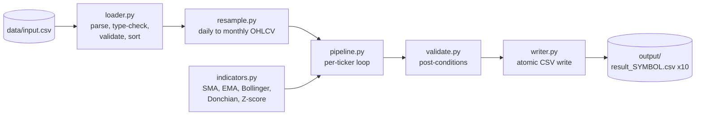

  [](https://github.com/anjaliy11/FAM_Monthly_indicators/actions/workflows/ci.yml)

# Monthly OHLC + Technical Indicators Pipeline

Transforms daily stock prices (10 tickers, 2018-2019) into monthly OHLC bars with technical indicators, and writes one CSV per ticker.

- **Input:** `data/input.csv` (5,030 daily rows: `date, volume, open, high, low, close, adjclose, ticker`)
- **Output:** `output/result_{SYMBOL}.csv`, 10 files, 24 rows each (2018-01 to 2019-12)
- **Stack:** Python 3.11 and **pandas only** at runtime. No TA libraries; calculations are vectorized (`groupby`, `agg`, `rolling`, `ewm`), with no row loops in the calculation code.

## Quick start

Requires Python 3.11 or newer.

```bash
# 1. Create and activate a virtual environment
python -m venv .venv
source .venv/bin/activate          # macOS / Linux
.venv\Scripts\activate             # Windows (PowerShell / cmd)

# 2. Install the runtime dependency (pandas)
pip install -r requirements.txt

# 3. Run the pipeline
python main.py
```

Default paths are anchored to the project root, so this works from any working directory. Optional flags: `--input PATH`, `--output-dir PATH`. Exit code is `0` on success and `1` on expected validation or file errors.

To run the tests and linter:

```bash
pip install -r requirements-dev.txt
pytest
ruff check .
```

## Architecture



Only `loader.py` reads files and only `writer.py` writes files. `resample.py`, `indicators.py`, `pipeline.py` and `validate.py` are pure: DataFrames in, DataFrames out. `pipeline.py` holds the pure per-ticker build functions plus the run_pipeline orchestrator, which calls the loader and writer.All 10 frames are built and validated before any file is written.

## Project layout

```text
.
├── .github/workflows/ci.yml
├── data/input.csv       # dataset provided in assignment(renamed file)
├── fam_pipeline/
│   ├── config.py        # constants: windows, tickers, columns, paths
│   ├── loader.py        # read + validate input (only reader)
│   ├── resample.py      # daily -> monthly OHLCV
│   ├── indicators.py    # sma, ema, bollinger, donchian, zscore
│   ├── pipeline.py      # per-ticker orchestration
│   ├── validate.py      # output post-conditions
│   └── writer.py        # atomic CSV writes (only writer)
├── tests/
├── output/              # result_{SYMBOL}.csv x10
├── main.py              # CLI entry point
├── pyproject.toml       # ruff config
├── requirements.txt     # pandas only
├── requirements-dev.txt # pytest, ruff
└── README.md
```

## Output schema

| Column | Meaning |
|---|---|
| `ticker` | Ticker symbol |
| `month` | `YYYY-MM` |
| `open` | Open of the month's **first** trading day |
| `high` | Highest high in the month |
| `low` | Lowest low in the month |
| `close` | Close of the month's **last** trading day |
| `volume` | Sum of daily volume (extra column, see assumptions) |
| `sma_10`, `sma_20` | Simple moving average of monthly closes |
| `ema_10`, `ema_20` | Exponential moving average of monthly closes (SMA-seeded) |
| `donchian_upper_20` | Rolling 20-month max of monthly `high` |
| `donchian_lower_20` | Rolling 20-month min of monthly `low` |
| `donchian_mid_20` | `(upper + lower) / 2` |
| `bb_mid_20` | 20-month rolling mean of close |
| `bb_upper_20`, `bb_lower_20` | `mid ± 2 * sd` (sample std, ddof=1) |
| `zscore_20` | `(close - rolling mean) / rolling std`, 20 months |

Values are written with 4 decimal places; NaN is written as an empty cell.

## Formulas

| Indicator | Implementation |
|---|---|
| SMA(n) | `close.rolling(n).mean()` |
| EMA(n) | multiplier `k = 2/(n+1)`; first EMA = SMA of first n closes; then `EMA_t = (P_t - EMA_{t-1}) * k + EMA_{t-1}` |
| Bollinger | `mid = c.rolling(n).mean(); sd = c.rolling(n).std(); upper/lower = mid ± k*sd`, n=20, k=2 |
| Donchian | `h.rolling(n).max()`, `l.rolling(n).min()`, n=20 |
| Z-score | `(close - rolling_mean(n)) / rolling_std(n)`, n=20; zero std gives NaN |

## Assumptions

1. **Raw `close` is used, not `adjclose`.** Open/High/Low/Close in the input are unadjusted; `adjclose` differs from `close` for AAPL, CSCO, MSFT and PEP. Mixing adjusted and raw prices would corrupt the monthly candle.
2. **Indicators use monthly closes** (monthly High/Low for Donchian), as the brief specifies, not daily data.
3. **EMA is SMA-seeded**, following the brief's formula. Pandas' default `ewm(span=n, adjust=False)` seeds with the first price and would give values from month 1, but it does not match the written formula.
4. **Leading rows are NaN until a full window exists.** There is no backfill and no partial-window values. With 24 months, `sma_10` and `ema_10` have 9 leading NaNs (15 valid rows). Every 20-window indicator (`sma_20`, `ema_20`, the three Bollinger columns, the three Donchian columns, `zscore_20`) has 19 leading NaNs (5 valid rows). This is inherent to a 20-month window on a 24-month dataset.
5. **Windows:** 10 and 20 for SMA/EMA. The brief gives no window for Bollinger, Donchian or Z-score, so 20 is used for all three (the standard default, and consistent with each other).
6. **Standard deviation is the sample std (ddof=1)**, matching pandas' `.std()` as written in the brief.
7. **Z-score is rolling**, not full-sample, so no future data leaks into earlier rows. Z-score equals ±2 exactly at the Bollinger bands.
8. **`volume` (monthly sum) is an extra column** beyond the brief. It is kept because it is part of the input and standard in monthly OHLCV.
9. **`month` is a `YYYY-MM` string**; the month label is derived from the trading date.
10. **Tickers and months are fixed by the brief.** The pipeline expects exactly the 10 listed tickers and 24 contiguous months (2018-01 to 2019-12), and fails loudly otherwise.

## Design decisions

- **`groupby` on month, not `resample`.** `resample` inserts NaN rows for months with no data, which would silently break the 24-row guarantee. Grouping on `date.dt.to_period("M")` only yields months that exist, and validation then asserts exactly 24 contiguous months.
- **Explicit sort before any `first`/`last`/`rolling`.** The input file is shuffled (not ordered by date or ticker). `first` and `last` are positional, so skipping the sort would silently produce wrong Open/Close values.
- **Per-ticker isolation.** Rolling and EWM run inside a per-ticker loop (10 iterations). A rolling window on the stacked frame would leak one ticker's tail into the next ticker's head.
- **Rounding only at write time.** Input prices carry float32 noise (for example `59.630001068115234`); calculations use full precision.
- **Fail loudly** Bad input raises an error naming the column or offending rows where possible, and nothing is dropped. The only normalization is trimming and uppercasing ticker symbols.
- **Atomic output.** Frames are validated first, then each CSV is staged and moved into place, so a failure never leaves a half-written `output/`.

## Validation

**Input checks (`loader.py`):** required columns, parseable dates, numeric prices and volume, positive prices, non-negative volume, no duplicate `(ticker, date)`, no nulls, ticker set equals the expected 10.

**Output checks (`validate.py`):** exactly 10 frames, 24 rows each, exact column order, contiguous months 2018-01 to 2019-12 in ascending order, ticker column matches the file, no `inf`, NaN only in the expected leading positions, `high >= max(open, close)`, `low <= min(open, close)`, `bb_upper >= bb_mid >= bb_lower`, `donchian_upper >= donchian_mid >= donchian_lower`.

## Testing

36 tests (`pytest`). Highlights:

- **Independent oracle:** recomputes every monthly value and indicator from the raw CSV with plain Python loops (not the production code) and compares all 10 files, all rows and columns. Maximum difference is below `5e-5`, which is the 4-decimal rounding.
- **Shuffle invariance:** shuffled and sorted input produce identical output.
- **Hand-built cases** for OHLC, SMA, EMA recurrence, Bollinger and Z-score identities, constant series (NaN, not inf).
- **No cross-ticker leakage**, and a `resample("MS")` cross-check of the monthly OHLC.
- **Open/Close correctness** against the raw first and last trading days of each month.
- **Output contract:** 10 files named `result_{SYMBOL}.csv`, 24 rows, expected columns, no stray files.
- **Atomic write, determinism (byte-identical reruns), exit codes, and loader rejection cases.**
- **Mutation-verified during development:** deliberately breaking the code (removing the sort, using pandas' default EMA seed, ddof=0, `adjclose`, stacked-ticker rolling, `min_periods=1`, shifting indicators by one row) was run once in disposable copies, and the suite failed on every mutation. The mutation script is not part of the repo.

Tested with Python 3.11 on pandas 2.x and 3.0. CI (`.github/workflows/ci.yml`) runs `ruff` and `pytest` on every push.

